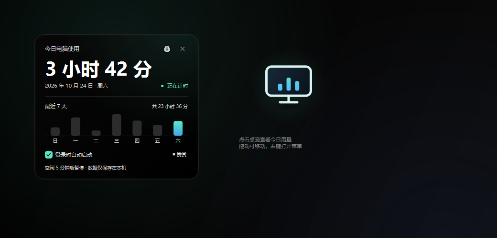
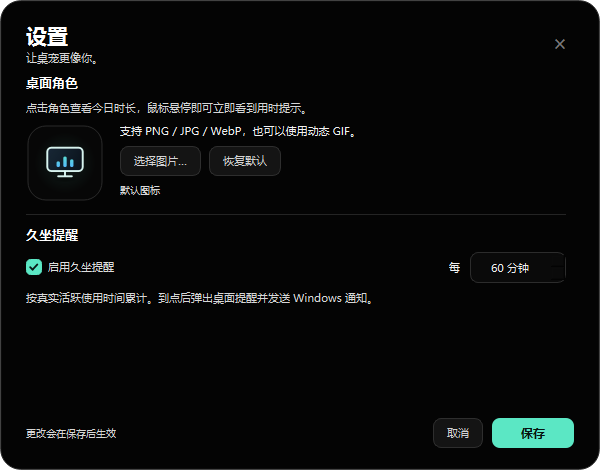

# MyScreenTime

> 一个安静地待在桌面角落的 Windows 使用时长桌宠。  
> 点一下看看今天用了多久电脑，连续使用 60 分钟时提醒你起身活动。



**[在线下载页](https://mzmxoyz.github.io/MyScreenTime/)**　·　**[下载 Windows 版（v1.8.0）](https://github.com/mzmxoyz/MyScreenTime/releases/latest/download/MyScreenTime-v1.8.0-win64.zip)**

Windows 10 / 11 64 位　·　免安装　·　无需 Python

---

## 为什么做这个项目

市面上的屏幕使用时间工具，大多要求注册账号、同步云端，或者在后台塞进一堆与「看时间」无关的功能。但很多时候我想要的只是一个很轻的东西：

- 它安静地待在桌面角落，不挡事；
- 点一下就能知道今天用了多久；
- 坐得太久时提醒我起来走走；
- 所有数据只留在自己电脑里。

于是我做了 MyScreenTime：一个用 PySide6 写的 Windows 桌面悬浮桌宠。它不登录、不联网、没有广告，也不会上传你的使用记录。

## 它能做什么

- **今日使用时长**：点击桌宠展开详情卡片，查看今天和最近 7 天的真实活跃使用时间。
- **真实活跃统计**：只在屏幕未锁定、最近有键鼠输入时累计；空闲 5 分钟后自动暂停，不会把挂机时间算进去。
- **60 分钟久坐提醒**：按真实活跃时间累计，到点弹出提醒卡片，支持「休息一下」和「10 分钟后提醒」。
- **自定义桌面角色**：支持 PNG、JPG、WebP 和动态 GIF；白底图片会自动去除与边缘相连的背景，保留透明悬浮感。
- **原生拖动**：拖动交给 Windows 原生移动循环，鼠标与窗口严格 1:1，靠近屏幕边缘自动吸附。
- **智能显示/隐藏**：手动隐藏后计时和提醒继续；全屏游戏或视频时自动隐藏，提醒排队保留，退出全屏后集中提示。
- **开机自启 + 托盘常驻**：登录 Windows 后静默启动，托盘菜单提供设置、暂停、隐藏和退出。
- **单实例**：重复启动不会出现多个桌宠。
- **纯黑界面**：低干扰、适合长时间放在桌面角落。

## 界面

| 今日时长与趋势 | 设置 |
| --- | --- |
|  |  |

| 久坐提醒 |
| --- |
|  |

## 下载与安装

1. 下载 [MyScreenTime-v1.8.0-win64.zip](https://github.com/mzmxoyz/MyScreenTime/releases/latest/download/MyScreenTime-v1.8.0-win64.zip)。
2. 完整解压出 `MyScreenTime` 文件夹。
3. 双击 `MyScreenTime.exe`。

整个文件夹就是程序，不需要安装器。移动或分享时请保留：

```text
MyScreenTime.exe
_internal\
使用说明.txt
```

如果 Windows 提示「已保护你的电脑」，点击「更多信息」→「仍要运行」。这是未购买商业代码签名证书的程序常见的 SmartScreen 提示，不是病毒提示。

## 数据与隐私

- 使用时长、提醒进度、自定义角色资源只保存在本机。
- 默认位置：`%LOCALAPPDATA%\MyScreenTime`。
- 不上传、不同步、不包含统计或遥测。
- 删除数据文件夹即可恢复首次运行状态。

## 技术实现

- **Python 3.13 + PySide6（Qt 6）**
- 无边框、透明、置顶的 `Qt.Tool` 窗口，角色和卡片全部用 `QPainter` 自绘
- 通过 `GetLastInputInfo` 和 `OpenInputDesktop` 判断活跃/锁屏
- 通过 Windows 原生 `WM_NCLBUTTONDOWN` 完成拖动
- 通过 `SHQueryUserNotificationState` + 前景窗口矩形判断真正的全屏应用
- 原子写入 JSON，按天滚动记录
- 单实例通过 `QLocalServer` / `QLocalSocket` 握手
- 开机自启写入当前用户 `Run` 注册表；权限不足时回退到 Startup VBScript

## 常见问题

**会联网上传数据吗？**  
不会。程序只使用本地文件，没有账号系统，也没有云端同步。

**为什么 Windows 提示不安全？**  
EXE 没有商业代码签名证书。可以核对压缩包的 SHA-256，或自行从源码构建。

**隐藏桌宠后还会提醒吗？**  
会。手动隐藏只收起桌宠，托盘和久坐提醒继续；全屏时提醒会排队，退出全屏后提示。

**怎么完全退出？**  
右键托盘图标 → 退出 MyScreenTime。若不需要开机自启，先在右键菜单关闭。

## 校验值

```text
SHA-256: 792c8fccf6ce1f2fd5022fb52408ca1a2afd4fe9fb71342c8216cda59c177da5
```

## 版本

当前版本：**v1.8.0**（2026-10）

---

如果这个小工具帮到了你，欢迎在应用里点一下「♥ 赞赏」。  
也欢迎把它分享给同样需要「看一眼今天用了多久」的人。
